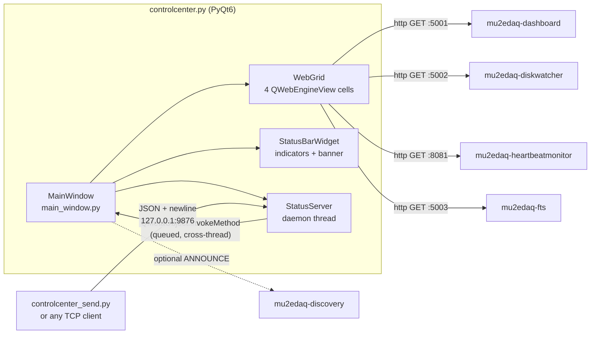

# mu2edaq-controlcenter

> PyQt6 kiosk that tiles the other DAQ packages' web dashboards into a resizable grid and exposes a TCP JSON status protocol so external processes can drive its indicator bar and message banner.

| | |
|---|---|
| Repository | `Mu2e/mu2edaq-controlcenter` |
| Language | Python 3.9+ (PyQt6, PyQt6-WebEngine, PyYAML) |
| Ports | 9876/tcp (status command server, loopback by default) |
| Depends on | `mu2edaq-dashboard`, `mu2edaq-diskwatcher`, `mu2edaq-heartbeatmonitor`, `mu2edaq-fts`, `mu2edaq-discovery` (optional) |

## Purpose

The control room wall needs one screen that shows four independently
developed web dashboards at once, plus a coarse red/amber/green summary
that a shifter can read from across the room. This package is that
screen. It owns no monitoring logic of its own: every cell is a
`QWebEngineView` pointed at another package's HTTP port, and every
indicator is set by an external process over a socket.

That inversion is the important architectural fact. The Control Center
never polls, never scrapes, and has no model of whether the DAQ is
healthy. It renders what it is told. If nothing calls `set_status`, all
four indicators sit at `unknown` indefinitely and the display is still
"working" as designed.

## Architecture



### Threading model

Two threads, one boundary, and the boundary is enforced properly.

`StatusServer` is a `threading.Thread(daemon=True)` (`src/status_server.py:35`)
with a 1.0 s `accept()` timeout so `stop()` is responsive
(`status_server.py:63`). Each client gets a further daemon thread
(`status_server.py:77-82`), so a slow client cannot block the listener.

Every mutating command crosses into the GUI thread through
`QMetaObject.invokeMethod(..., Qt.ConnectionType.QueuedConnection)`
(`main_window.py:319-327`) targeting `@pyqtSlot`-decorated methods. No
widget is touched from the socket thread. The one exception is
`get_status`, which reads `_status_bar_widget._indicators` directly
(`main_window.py:358-363`) — a read of Python dict state, tolerable, but
it does reach into a private attribute of another object.

The consequence of `QueuedConnection` is that `{"status":"ok"}` means
*queued*, not *applied*. An unknown indicator name is reported `ok` and
then silently discarded by the slot. See `INTERFACES.md`.

### Port override chain

`config/controlcenter.yaml:48` declares `status_server.port: 9876`.
`src/controlcenter.py:87-89` overrides it from `CRS_PORT_CMD` when that
variable is set and non-empty. Both launchers export that variable from
`apps.yaml` (`ports: {cmd: 9876}`), so the config value and the
inventory value agree today and the override is a no-op in practice —
it exists so the inventory can move the port without editing this repo.

Only the port is overridable. `status_server.host` has no environment
override, which is deliberate: the control-room launch path cannot
accidentally widen a loopback bind to a routable one.

## Components

| File | Role |
|---|---|
| `src/controlcenter.py` | Entry point; argparse, config load, `CRS_PORT_CMD` override (`:87`), optional discovery responder (`:96-104`) |
| `src/main_window.py` | Window, menus, command dispatch (`_handle_command`, `:308`), layout save/load |
| `src/web_grid.py` | Grid of `QWebEngineView` cells; drag-to-swap, per-cell zoom, splitters |
| `src/status_bar_widget.py` | Indicator chips (`ok`/`warning`/`error`/`unknown`) and the message banner |
| `src/status_server.py` | TCP listener and per-client threads; JSON framing |
| `src/config_loader.py` | YAML load, merge over `DEFAULT_CONFIG`, validation/coercion |
| `src/controlcenter_send.py` | Standalone CLI client (stdlib only; no Qt import) |
| `src/stylesheets.py` | Nine built-in QSS themes, applied from the View menu |

`controlcenter_send.py` deliberately imports only `argparse`, `json`,
`socket` and `sys`. It runs on a host with no PyQt6 installed, which is
what makes it usable from cron, from a DAQ script, or over ssh.

## Interfaces

See `INTERFACES.md` for the full protocol. In summary: one TCP port,
newline-delimited JSON, six commands, no authentication.

## Configuration

`config/controlcenter.yaml`. There is no environment or command-line
override for anything except the config path (`--config`) and the port
(`CRS_PORT_CMD`), so this package does not implement the project-wide
four-layer precedence convention that `mu2edaq-desktop` and
`mu2edaq-controlroom-setup` do.

```yaml
title: "Mu2e DAQ Control Center"
grid: {rows: 2, cols: 2}
status_indicators:            # names here are the only valid set_status targets
  - {name: "DAQ", state: unknown}
pages:                        # each becomes a QWebEngineView cell
  - {name: "Dashboard", url: "http://localhost:5001", position: [0, 0]}
status_server: {host: "127.0.0.1", port: 9876}
```

`config_loader.py` coerces rather than rejects: an out-of-vocabulary
indicator state becomes `unknown` (`config_loader.py:50-51`), a missing
URL becomes `about:blank` (`config_loader.py:61`), and a malformed
`position` becomes `None` and is auto-placed. A typo in the config
produces a running but wrong display rather than a startup error.

The four sibling packages are hard-coded as `localhost` URLs at
`config/controlcenter.yaml:29,32,35,38`. Nothing validates them against
`apps.yaml`; see the finding below.

## Operations

See `OPERATIONS.md`.

## Interactions with other packages

| Package | Direction | Mechanism | Evidence |
|---|---|---|---|
| `mu2edaq-dashboard` | out | HTTP GET into a grid cell, port 5001 | `config/controlcenter.yaml:29` |
| `mu2edaq-diskwatcher` | out | HTTP GET into a grid cell, port 5002 | `config/controlcenter.yaml:32` |
| `mu2edaq-heartbeatmonitor` | out | HTTP GET into a grid cell, port 8081 | `config/controlcenter.yaml:35` |
| `mu2edaq-fts` | out | HTTP GET into a grid cell, port 5003 | `config/controlcenter.yaml:38` |
| `mu2edaq-discovery` | out | optional `Responder` advertising the status port | `src/controlcenter.py:98-101` |
| `mu2edaq-desktop` | in | launched as `mu2edaq-app start controlcenter`; supplies `CRS_PORT_CMD` | `../mu2edaq-desktop/config/apps.yaml:23-30` |
| `mu2edaq-controlroom-setup` | in | launched as `crs-app start controlcenter` on the `shift-main` session | `../mu2edaq-controlroom-setup/config/apps.yaml:17-25` |

The discovery dependency is soft by construction: the import sits in a
`try`/`except Exception` that prints and continues
(`src/controlcenter.py:96-105`), so a host without the package still
starts the kiosk.

These four URLs are dependency edges in the deployment graph but are
invisible to every tool that reasons about the graph, because they are
URL strings in this package's own config rather than entries in the
shared inventory.

## Review findings

| ID | Sev | Title |
|---|---|---|
| CC-001 | S3 | Embedded dashboard URLs duplicate `apps.yaml` ports with no cross-check |
| CC-002 | S3 | No test suite for a package with a network-facing protocol |
| CC-003 | S3 | No CI |
| CC-004 | S4 | `doc/` was an empty committed directory |
| CC-005 | S4 | Man pages were in a flat `man/` with non-conforming `.TH` |
| CC-006 | S4 | `CLAUDE.md` claims layout is persisted on exit; the code only saves on request |

Details and fingerprints in `ISSUES-PENDING.md`.
